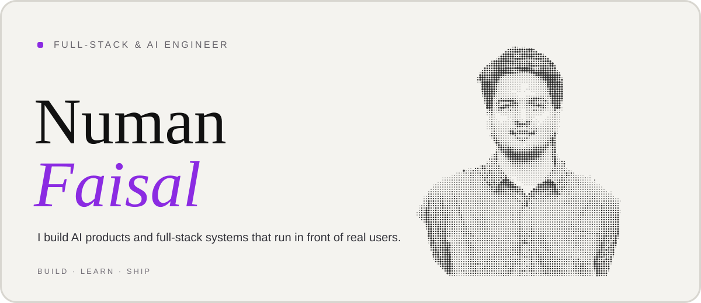
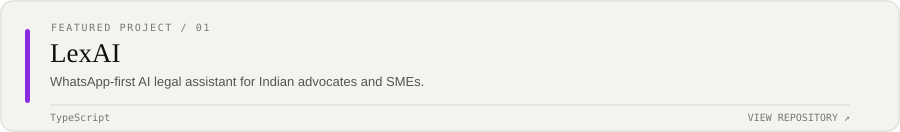

## What I'm building

<a href="https://github.com/NumanFaisal">GitHub</a> · <a href="https://www.linkedin.com/in/numan-faisal-2580a3219/">LinkedIn</a> · <a href="mailto:numanfaisal980@gmail.com">Email</a>

