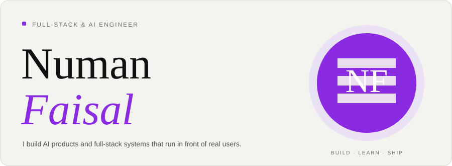
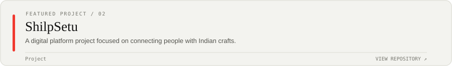
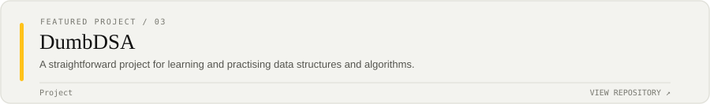

 
 
 
 
<picture><source media="(prefers-color-scheme: dark)" srcset="./cards/title-coding-dark.svg"></picture> 
"></a>

<a href="https://github.com/NumanFaisal">GitHub</a> &nbsp;/&nbsp; <a href="https://www.linkedin.com/in/numan-faisal-2580a3219/">LinkedIn</a> &nbsp;/&nbsp; <a href="mailto:numanfaisal980@gmail.com">Email</a>

